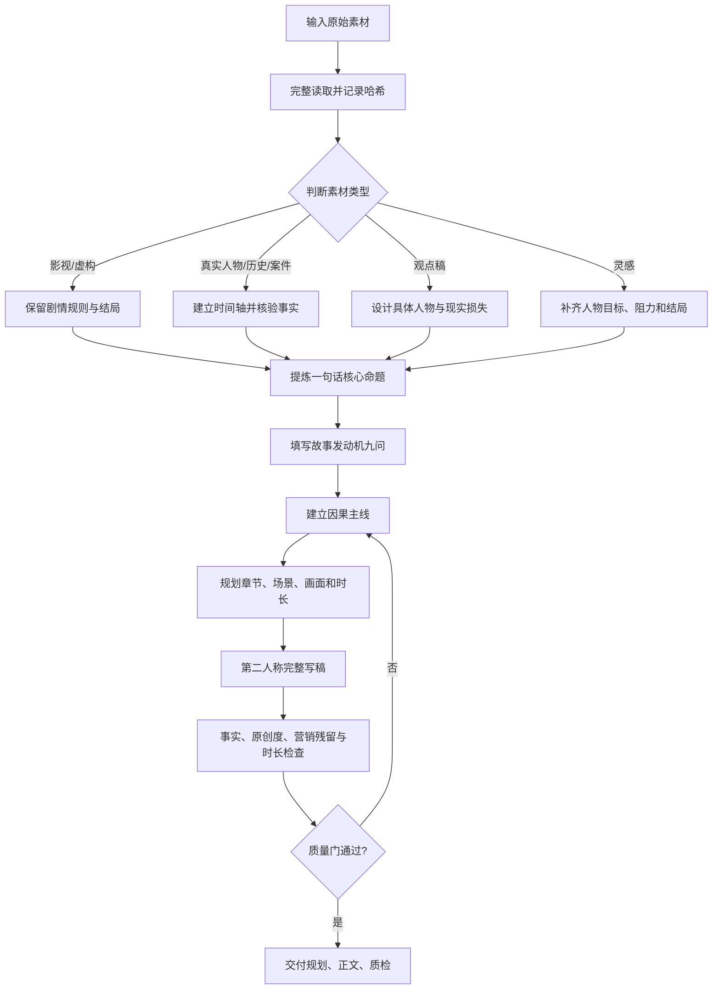

# 人生副本写稿技能：流程、规则与迁移指南

## 1. 这套技能解决什么问题

`write-life-script` 用于把以下素材改写成可以直接进入配音和分镜阶段的中文人生故事：

- 影视解说或纯文本字幕
- 人物传记、体育人物、历史人物
- 案件材料
- 财经、技术或社会观点稿
- 用户提供的创意、灵感和故事梗概

它不是简单润色，也不是把第三人称逐句改成“你”。它执行的是一次完整的故事重编译：

```text
原始素材
→ 判断素材类型与可信度
→ 提炼真正的故事命题
→ 找出主角的错误保护策略
→ 重建因果主线
→ 设计章节、场景和时长
→ 写成第二人称完整旁白
→ 核验事实、原创度和口播质量
→ 输出规划、正文、质检三份文件
```

## 2. 核心判断

这套写法最关键的不是文笔，而是下面三个判断。

### 2.1 故事真正讲的是什么

不能停留在“母爱”“坚持”“抓住机会”等抽象主题，要找到人物的具体矛盾。

例如：

- 不是“珍惜母亲”，而是“主角把远离母亲误认为保护，保存了吃饭次数，却失去了十五年共同生活”。
- 不是“AI 是趋势”，而是“普通人承担不起一次豪赌，所以要把试错拆成每天可承受的小实验”。
- 不是“朱棣功绩很大”，而是“靠内战上位的皇帝如何用大型工程和扩张重建合法性，又给继承者留下必须收缩的成本”。

### 2.2 主角相信了什么错误但合理的办法

完整故事通常都有一个“错误保护策略”：

- 为了保护母亲，所以离开母亲。
- 为了不连累爱人，所以擅自提出分手。
- 为了避免失败，所以永远等待百分之百确定。
- 为了证明权力合法，所以不断扩大控制和工程。

这个办法必须合理到观众能够理解，同时错误到它会持续制造代价。

### 2.3 最终行动有没有推翻原来的错误办法

人物成长不能只靠旁白说“他终于明白了”。必须出现相反的行动：

- 过去逃离餐桌，最后主动给母亲做饭。
- 过去嘲笑 AI，最后把行业经验做成可以审核的工作流。
- 过去替别人决定，最后把选择权还给对方。

结尾的动作就是主题，不需要再追加几段说教。

## 3. 总体工作流



## 4. 输入处理

### 4.1 完整读取

必须读取全文，不能只看标题或前几段。读取后记录：

- 文件绝对路径
- 字符数与段落数
- SHA256
- 主角及主要人物
- 时间跨度
- 结局和关键反转
- 原稿中明显的营销、说教、重复和不可靠信息

原始文件保持不变，所有输出写入新目录。

### 4.2 素材分类

| 素材 | 首要工作 | 必须避免 |
|---|---|---|
| 影视故事 | 保住规则、人物动机和反转 | 按镜头流水账复述 |
| 真实人物 | 时间轴、公开事实、长期关系 | 神化、编造引语和心理 |
| 历史 | 选择、工程、制度和代价 | 把集体劳动全算给一个人 |
| 案件 | 证据链和悬念顺序 | 开头公布凶手、猎奇受害者 |
| 观点稿 | 把观点变成人物选择 | 数据堆积、恐吓观众 |
| 灵感稿 | 补齐因果与完整结局 | 只有设定，没有事件 |

## 5. 提炼故事发动机

正式写作前必须回答以下九问：

1. 主角是谁，现在处于什么生活状态？
2. 主角最想获得或守住什么？
3. 主角最害怕失去什么？
4. 主角相信哪一种错误但合理的解决办法？
5. 这个办法第一次造成什么损失？
6. 哪个事件让旧办法失效？
7. 最低谷时，主角准备放弃什么？
8. 最后他主动做了什么不同的选择？
9. 这个选择产生了什么可见结果？

若第 4、8、9 问无法回答，说明素材还没有成为完整故事。

## 6. 重建因果主线

每个章节都应当符合：

```text
因为 A 发生
主角相信 B
所以选择 C
结果造成 D
D 又迫使主角面对 E
```

如果两段之间只能用“然后”连接，通常表示它们只是时间相邻，并没有形成故事。

可以调整原稿顺序：

- 把后文才解释的童年创伤提前到能够支撑当前选择的位置。
- 把同一场景的多句台词合并，不因每句话创建新场景。
- 把多次相同争吵压缩成一次真正改变关系的冲突。
- 把原作者的总结改成一个可见后果。

## 7. 开场钩子

默认必须使用：

```text
今天你要体验的人生副本是：
```

后面使用：

```text
身份 + 异常规则或即时危机 + 极端选择 + 未解问题
```

开场需要让观众知道：

- 主角是谁
- 现在遇到了什么
- 为什么必须选择
- 这个选择为什么反常或代价巨大

开场不能直接公开：

- 最终凶手
- 最终生死结果
- 奇幻规则的最终解释
- 人物一生完整功过

## 8. 章节、场景与画面

常用结构为九段，但不是固定模板：

1. 即时危机或异常规则
2. 原有生活与人物缺口
3. 第一次错误选择
4. 暂时成功
5. 更大代价或中点揭示
6. 旧办法彻底失效
7. 最低谷和最后选择
8. 高潮行动
9. 结果与开头回声

场景规划遵循：

- 同一地点、时间和人物目标属于同一场景。
- 两句台词不等于两个场景。
- 用景别、动作、表情、视线和道具变化推进同一场景。
- 先规划人物年龄版本、核心地点和反复出现的道具。
- 同一视觉母题至少出现三次，才具备回收效果。

## 9. 正文写法

### 9.1 第二人称

主角统一使用“你”。配角使用姓名、身份或关系称谓。不能中途切回“他”。

### 9.2 口播句法

- 一个自然段承载一个动作、判断或转折。
- 句子短，但不能为了短而破坏完整语义。
- 先写观众能看见的动作，再补必要心理。
- 不用多个同义形容词重复证明“很感人”“很痛苦”。
- 对话只保留会改变信息、关系或决定的内容。

### 9.3 数字和 TTS

正文中的年份、数量和金额尽量转换为自然中文读法，例如：

- `2026 年` → `二〇二六年`
- `105 万英镑` → `一百零五万英镑`
- `2:1` → `二比一`

小数、时间和特殊符号必须保留真实含义，不能机械删除。

### 9.4 结尾

优先使用：

- 核心数字发生变化
- 开场场景再次出现，但人物行动相反
- 主角完成过去不敢做的事情
- 一个真实后果回答全部争论

避免：

- “所以我们一定要珍惜……”
- “你怎么看？”
- “评论区告诉我。”
- “点赞关注，下期继续。”

## 10. 事实核验

下列内容必须联网确认：

- 最新比赛、奖项、职位、转会和婚姻状态
- 当前财报、价格、政策和法律
- 医疗、金融和法律等高风险信息
- 记忆不确定或存在明显争议的历史说法

优先来源：

1. 政府、法院、博物馆、档案馆、赛事官网和公司投资者关系页面
2. 原始访谈、正式公告和学术论文
3. 信誉良好的主流媒体
4. 聚合站和自媒体只能提供线索

事实来源写进《质量检查》，不要把网址塞进旁白正文。

## 11. 伦理与真实人物

技能默认执行以下修正：

- 删除身体羞辱和把伴侣物化为成功奖品的开场。
- 不因社交平台删除、沉默或一张照片推断真实人物心理。
- 不保留无法找到来源的“公开原话”。
- 不把传闻、粉丝猜测和作者想象写成事实。
- 不美化自杀、放弃治疗、赌博、借贷重仓等高风险行为。
- 可以保留人物的错误行为，但必须让后果说明其错误。

## 12. 时长计算

当前使用已经过真实 MiniMax 配音结果校准的速度：

```text
每秒 4.472 个可朗读字符
预计秒数 = 可朗读字符数 / 4.472
```

参考值：

| 可朗读字符 | 预计时长 |
|---:|---:|
| 1900 | 约 7 分 05 秒 |
| 2200 | 约 8 分 12 秒 |
| 2650 | 约 9 分 53 秒 |
| 2850 | 约 10 分 37 秒 |
| 3200 | 约 11 分 55 秒 |

时长应当服从故事复杂度：

- 单一人物弧线：7 至 9 分钟
- 完整电影或多阶段人物：9 至 11 分钟
- 复杂历史或案件：10 至 13 分钟

不要为了十分钟指标重复同一观点。

## 13. 原创化检查

将源稿和成稿同时去除：

- 空格和换行
- 标点
- 特殊符号

然后检查连续相同文本。默认不保留 8 个字及以上的直接复用。

例外包括：

- 人名和地名
- 官方赛事、组织和作品全名
- 法律名称和不可改写的固定术语

例外必须在《质量检查》中说明，不能为了规避重复而改错专有名词。

## 14. 三份固定交付

```text
输出目录/
├── 改编规划.md
├── 人生副本_<标题>_完整稿.txt
└── 质量检查.md
```

### 改编规划

包括：

- 类型、视角、冲突和命题
- 原稿删改原则
- 章节与画面数量
- 场景复用
- 人物年龄和资产一致性
- 预计时长

### 完整稿

只放可以直接配音的正文，不放 Markdown 标题、编号、引用网址、制作说明和时间码。

### 质量检查

包括：

- 字符、段落、句子和时长
- 第二人称数量
- 营销残留
- 最长源稿复用
- 事实或情节规则核验
- 删除和修正内容
- 源稿与成稿 SHA256

## 15. 自动检查脚本

技能内置：

```text
scripts/analyze_script.py
```

仅使用 Python 标准库，不需要安装第三方包。

运行方式：

```powershell
python scripts/analyze_script.py `
  --source "E:\path\source.txt" `
  --output "C:\path\final.txt" `
  --json "C:\path\analysis.json" `
  --strict
```

它会输出：

- 两个文件的 SHA256
- 总字符和可朗读字符
- 段落数和句子数
- 平均与最长句长
- 第二人称数量
- 配音预计时长
- 固定开场检查
- 营销词检查
- 最长连续源稿复用
- 总体通过状态

严格模式发现问题时返回非零状态，方便 Agent 自动修稿后重新检查。

## 16. 技能目录

```text
write-life-script/
├── SKILL.md
├── agents/
│   └── openai.yaml
├── references/
│   ├── workflow.md
│   └── output-templates.md
└── scripts/
    └── analyze_script.py
```

技能不包含任何源稿、API Key、账号、模型配置或用户隐私，可以独立复制。

## 17. 在另一台 Codex 电脑上安装

### Windows

1. 解压便携包。
2. 将整个 `write-life-script` 文件夹复制到：

```text
%USERPROFILE%\.codex\skills\write-life-script
```

3. 确认以下文件存在：

```text
%USERPROFILE%\.codex\skills\write-life-script\SKILL.md
```

4. 新建 Codex 任务，或者重启应用，让技能目录重新扫描。
5. 使用显式调用测试：

```text
使用 $write-life-script，把这个纯文本稿改写成人生副本完整稿，并输出规划、正文和质量检查。
```

### macOS 或 Linux

将文件夹复制到：

```text
~/.codex/skills/write-life-script
```

然后重新打开任务并显式调用 `$write-life-script`。

## 18. 部署到其他 Agent

### 支持 Skills 目录的 Agent

把完整文件夹复制到该 Agent 配置的技能目录。不能只复制 `SKILL.md`，因为详细工作流、模板和检查脚本都通过相对路径引用。

### 不支持 Skills 的 Agent

按以下方式降级使用：

1. 将 `SKILL.md` 作为系统提示或长期项目指令。
2. 把 `references/workflow.md` 和 `references/output-templates.md` 放入知识库或项目文档。
3. 告诉 Agent 在写稿前必须读取这两个文件。
4. 允许 Agent 调用本机 Python 运行 `analyze_script.py`。
5. 若无法运行脚本，至少人工执行固定开场、第二人称、时长、营销残留和事实核验检查。

## 19. 推荐调用方式

### 直接给文件

```text
使用 $write-life-script 处理：
E:/素材/某电影_校订纯文本稿.txt

按人生副本格式输出，不要提前透露结局，保留完整故事线。
```

### 真实人物

```text
使用 $write-life-script，把这份人物资料改写成人生副本。
最新比赛、奖项和公开引语必须联网核验，不要编造私人心理。
```

### 灵感改编

```text
使用 $write-life-script，把下面的灵感扩写成完整人生副本。
先补齐人物目标、错误策略、三次升级和最终行动，再写正文。
```

### 只要稿子

```text
使用 $write-life-script，给我稿子：<文件路径>
```

技能应当自行读取、规划、改写、检查和交付，不需要用户重复说明已固定的偏好。

## 20. 迁移后的验收

在新电脑上至少完成一次测试，检查：

- [ ] Agent 能识别 `$write-life-script`
- [ ] 会完整读取输入文件，而不是只看标题
- [ ] 输出三份文件
- [ ] 正文第一句使用固定开场
- [ ] 全文以“你”为主角视角
- [ ] 不在开场公布完整结局
- [ ] 质量检查包含预计时长和两个 SHA256
- [ ] 自动脚本返回 `passed: true`
- [ ] 真实人物或当前数据能够联网核验
- [ ] 原始文件未被修改

## 21. 可调参数

迁移后可根据新项目修改：

- 固定开场
- 配音速度 `4.472`
- 目标时长范围
- 连续复用阈值 `8`
- 营销词列表
- 每条字幕最大字符数 `20`
- 固定交付文件名
- 是否必须规划画面数量

修改以后应选择一篇已有原稿重新跑检查，避免规则之间发生冲突。

## 22. 能力边界

这个技能负责：

- 理解素材
- 设计故事
- 写旁白稿
- 规划画面
- 事实和原创化检查
- 输出制作前文档

它不直接负责：

- 生图
- TTS 请求
- SRT 强制对齐
- 视频渲染
- 剪辑和转场

这些属于后续生产技能。`write-life-script` 的职责是提供稳定、可配音、可分镜、可检查的上游文本契约。
